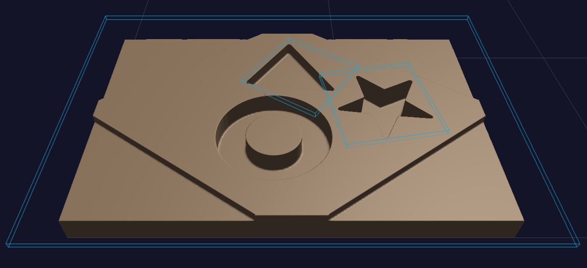
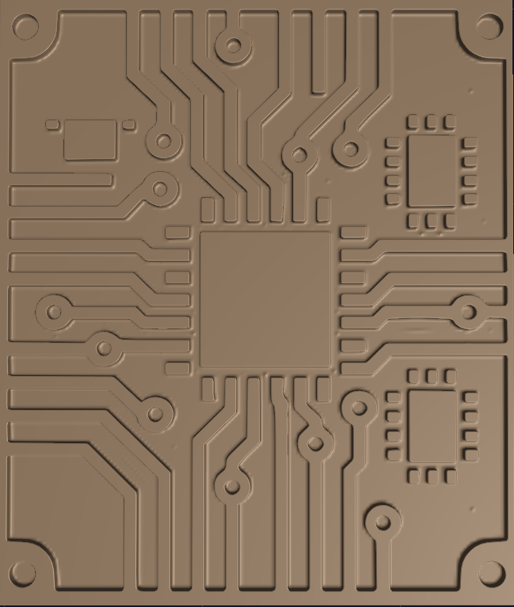
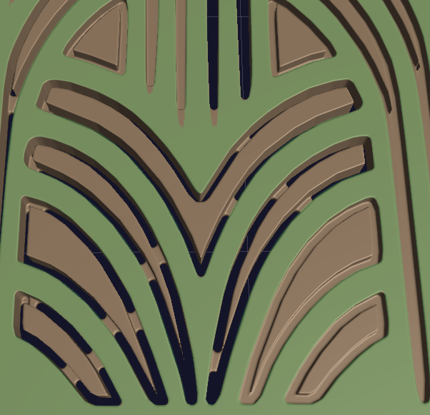
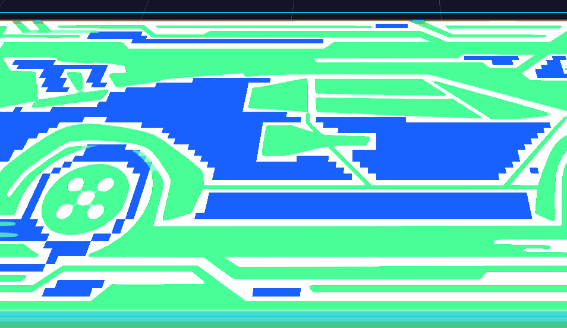
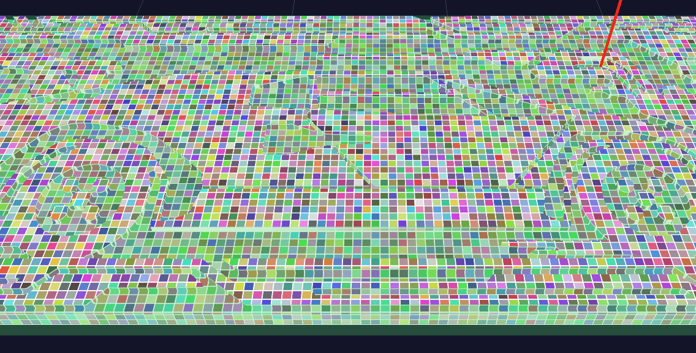

# RW.CSG

<p align="center">
	
</p>

Sparse signed-distance CSG and real-time CNC material-removal simulation for .NET 8 and .NET 9.

RW.CSG is a C# library for subtracting swept, revolved machining tools from solid stock. It stores the evolving workpiece as a persistent sparse narrow-band signed-distance field and includes a companion Avalonia app for live carving, timeline seeking, rendering, and diagnostics.

Project website: [reliefwood.com](https://reliefwood.com)

At the core of the project is a monotone subtractive CSG pipeline built around sparse voxel bricks, analytic swept-tool distance fields, and an OpenGL ES 3.0-compatible raymarch renderer. If you are looking for a C# or .NET library related to CNC stock simulation, signed-distance fields, swept-volume subtraction, undercut tool modeling, or real-time material removal, this repository is the relevant entry point.

## What This Project Covers

RW.CSG is aimed at problems that show up in CAM simulation, computational geometry, and interactive CNC visualization:

- Incremental material removal from solid stock along large toolpaths.
- Sparse signed-distance storage with physical distances in millimeters.
- Revolved cutter profiles assembled from cylinders, cones, hemispheres, tori, and truncated cones.
- Concave and undercut tools such as T-slot cutters.
- Brick-local parallel stamping with work independent of previously processed segment count.
- Interactive raymarched visualization and exact toolpath-step seeking.
- Mesh extraction, removed-volume tracking, and fine/coarse SDF sampling.

## Highlights

- Persistent sparse narrow-band SDF with slab-allocated `Half` voxel bricks.
- Monotone subtraction using `dNew = max(dStock, -dBrush)`.
- Batched, parallel material-removal stamping over brick-local stroke runs.
- Tool profiles baked from mirrored polygons or stacked revolved primitives.
- Path preprocessing that filters non-cutting moves and subdivides long cuts.
- Spatial path indexing and local brick rebaking for reconstruction workflows.
- Marching-tetrahedra iso-surface extraction.
- OpenGL ES 3.0-compatible sparse-volume raymarching through Silk.NET.
- Avalonia desktop viewer with orbit controls, playback, seeking, tool overlay, and live diagnostics.

## Preview Screenshots

These previews come from the companion Avalonia frontend and show finished cuts, PCB-style relief, and renderer diagnostics over the evolving signed-distance volume.











## Project Structure

| Path | Purpose |
| --- | --- |
| `RW.CSG/` | UI-independent sparse SDF, swept-tool, path-index, rebake, and mesh-export library |
| `RW.CSG.Rendering/` | Reusable Silk.NET OpenGL sparse-SDF raymarch renderer |
| `RW.CSG.Avalonia/` | Interactive desktop viewer and opt-in validation/performance diagnostics |
| `docs/images/` | README branding and preview images |
| `plan.md` | Architecture, correctness constraints, integration status, and measured baselines |

## Requirements

- .NET 9 SDK to build the full solution and run the Avalonia app.
- .NET 8 or .NET 9 for consumers of the core and rendering libraries.
- A graphics driver supported by Avalonia's desktop OpenGL/ANGLE backend for the viewer.
- An OpenGL ES 3.0-compatible feature path for sparse-volume rendering.

## Quick Start

Clone the repository, restore dependencies, and build the solution:

```powershell
dotnet restore .\RW.CSG.sln
dotnet build .\RW.CSG.sln -c Release
```

Launch the desktop viewer:

```powershell
dotnet run --project .\RW.CSG.Avalonia\RW.CSG.Avalonia.csproj -c Release
```

The default launch opens the interactive viewer. Validation and performance diagnostics are opt-in and do not execute during normal startup.

## Sparse SDF Architecture

`SparseSdfVolume` divides the stock into small bricks and allocates voxel storage only for bricks that contain an active surface. Untouched material and fully removed regions remain compact uniform brick states.

Each cutting segment contributes a swept-tool signed-distance field. Subtraction raises the stored stock field with `max(dStock, -dBrush)`, so edits are commutative, associative, idempotent, and safe to process in brick-owned parallel batches. A coarse whole-volume SDF accelerates far-field traversal, while the fine three-voxel narrow band preserves the active surface for rendering and extraction.

The renderer mirrors mixed bricks into a bordered 3D texture atlas and uses an indirection texture to distinguish solid, air, and allocated bricks. Render cost therefore follows pixels and ray steps rather than total toolpath history.

## Usage

### Stamp Material Removal

```csharp
using System.Numerics;
using RW.CSG;

var volume = new SparseSdfVolume(
	voxelsX: 320,
	voxelsY: 160,
	voxelsZ: 40,
	voxelSize: 0.25f,
	brickSize: 8,
	bandVoxels: 3);

volume.WriteEpsilon = volume.BandWorld / 1024f;

var tool = ToolProfile.FlatEndmill(
	radius: 3f,
	height: 12f,
	lutSize: 128);

PathSource.ToolMove[] moves =
[
	new(new Vector3(20f, 20f, 8f), new Vector3(60f, 20f, 8f), IsCutting: true),
	new(new Vector3(60f, 20f, 8f), new Vector3(80f, 20f, 8f), IsCutting: false)
];

PathSegment[] segments = PathSource.BuildCuttingSegments(
	moves,
	maxStep: volume.VoxelSize);

volume.StampBatch(
	segments,
	segStart: 0,
	segCount: segments.Length,
	tool,
	parallel: true);

Console.WriteLine($"Removed {volume.RemovedVolume:F2} mm^3");
```

### Build a Revolved Tool

Stacked profiles are ordered from the tool tip toward the shaft. Dimensions are radii and heights in millimeters.

```csharp
var stack = new SweptVolumeStack(
[
	SweptVolumeSegment.Cone(bottomRadius: 1f, topRadius: 5f, height: 15f),
	SweptVolumeSegment.Cylinder(radius: 7.5f, height: 8f),
	SweptVolumeSegment.Cylinder(radius: 3.175f, height: 80f)
]);

var profile = new ToolProfile(
	stack,
	radialLutSize: 256,
	axialLutSize: 1024,
	pad: 2f);
```

For a ready-made undercut profile, use `ToolProfile.TSlotCutter(...)`.

### Extract a Mesh

Mesh extraction returns vertices, normals, and triangle indices. Clone the volume first when the live instance may continue changing.

```csharp
SparseSdfVolume snapshot = volume.DeepClone();
MeshExport.Mesh mesh = MeshExport.Extract(snapshot, step: 1);

Console.WriteLine(
	$"{mesh.Vertices.Count} vertices, {mesh.Triangles.Count} triangles");
```

## Coordinate Conventions

- Geometry and distance values are expressed in millimeters.
- `X` and `Y` span the stock plane; `Z` is height above the stock base.
- Volume coordinates begin at `(0, 0, 0)` and extend through the configured voxel dimensions.
- Tool-profile axial height begins at the cutter tip and increases toward the shaft.
- SDF values use `d > 0` for air and `d < 0` for material.
- `RemovedVolume` is reported in cubic millimeters and is a sub-voxel occupancy estimate.
- The current CSG update is subtractive and monotone: removed material is not added back.

## Validation and Benchmarks

Run diagnostics in Release mode so performance-sensitive results are meaningful:

```powershell
dotnet run --project .\RW.CSG.Avalonia\RW.CSG.Avalonia.csproj -c Release -- --bench startup
dotnet run --project .\RW.CSG.Avalonia\RW.CSG.Avalonia.csproj -c Release -- --bench verify
dotnet run --project .\RW.CSG.Avalonia\RW.CSG.Avalonia.csproj -c Release -- --bench stack
dotnet run --project .\RW.CSG.Avalonia\RW.CSG.Avalonia.csproj -c Release -- --bench mesh
```

The suite also includes focused stamping, path-index, rebake, upload, seam, raymarch, live-pipeline, and seek diagnostics. Graphics benchmarks open a window; CPU-only checks run in the console. The complete inventory, expected gates, and measured reference-machine baselines are documented in `plan.md`.

## Development Notes

- The core library has no UI or graphics dependency and targets both .NET 8 and .NET 9.
- `RW.CSG.Rendering` uses Silk.NET for the OpenGL rendering path.
- The Avalonia frontend targets .NET 9 and acts as both an interactive viewer and a diagnostic harness.
- Fine SDF values are stored as `Half` but computed as `float`; all stored distances remain physical millimeters.
- Long cutting moves should pass through `PathSource.BuildCuttingSegments` before live stamping.
- Mesh export and other long-running reads should operate on an immutable clone while carving continues.
- Correctness and performance gates currently live in the opt-in benchmark suite rather than a separate test project.

## Related Problems

This repository should also be useful if you are exploring C# signed-distance fields, sparse voxel CSG, real-time CNC stock simulation, swept-volume subtraction, undercut cutter modeling, SDF raymarching with OpenGL ES 3.0, or mesh extraction from sparse implicit volumes. Those are nearby descriptions of the same implementation space this codebase is working in.

## Repository Guide

- Sparse volume and stamping: `RW.CSG/SparseSdfVolume.cs`
- Revolved tool profiles: `RW.CSG/ToolProfile.cs`
- Stacked tool primitives: `RW.CSG/SweptVolumeStack.cs`
- Swept-brush evaluation: `RW.CSG/SweptBrush.cs`
- Toolpath preprocessing: `RW.CSG/PathSource.cs`
- Spatial toolpath index: `RW.CSG/PathIndex.cs`
- Brick reconstruction: `RW.CSG/Rebake.cs`
- Mesh extraction: `RW.CSG/MeshExport.cs`
- Sparse raymarch renderer: `RW.CSG.Rendering/SparseSdfRaymarchRenderer.cs`
- Desktop viewer: `RW.CSG.Avalonia/`
- Architecture and measured baselines: `plan.md`

## Status

RW.CSG is structured as a working engineering codebase rather than a packaged SDK. The core material-removal pipeline, renderer, live playback, and seek path are implemented and benchmark-gated; APIs and desktop polish may continue to evolve as the integration is refined.

## License

RW.CSG is licensed under the [MIT License](LICENSE).

The Reliefwood name, website, logos, and other branding are not granted for reuse by the software license.
